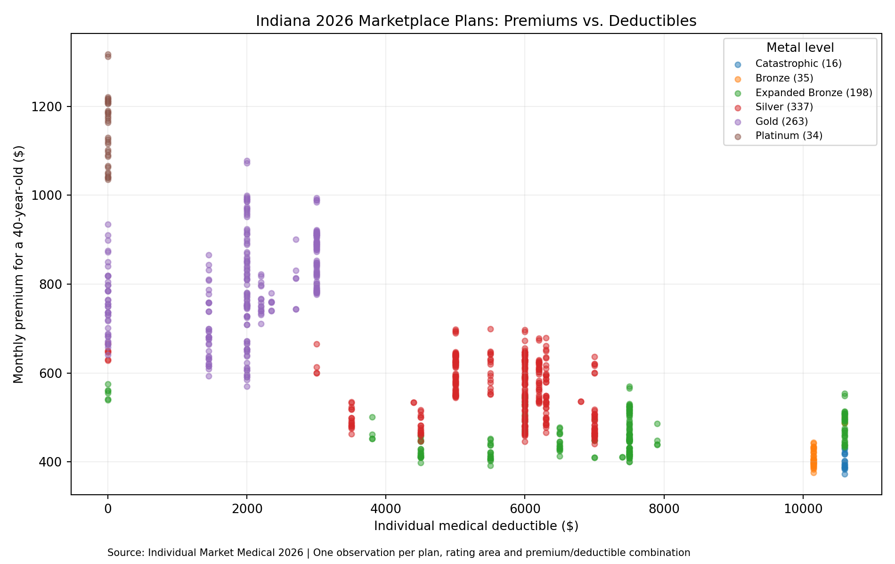

# Indiana Health Insurance Premiums and Deductibles Analysis

## Project Overview
This project analyzes the relationship between health insurance premiums and deductibles for individual health insurance plans in Indiana. The purpose is to better understand how insurance costs vary across plans and the financial trade-offs consumers face when selecting coverage.

## Data Source
The analysis uses the Individual Market Medical dataset, which contains information about health insurance plans, including premiums, deductibles, geographic locations, and coverage levels.

## Methodology
Using ChatGPT to assist with data analysis, I will:

1. Filter the dataset to include only Indiana health insurance plans.
2. Identify the individual medical deductible and monthly premium for a 40-year-old adult.
3. Create a scatter plot comparing premiums and deductibles.
4. Examine the relationship between the two variables and identify any noticeable patterns.

## Analysis and Findings

The analysis included 883 distinct Indiana health insurance plan and rating-area observations after removing repeated county listings. I compared the monthly premiums for a 40-year-old adult with individual medical deductibles.

The scatter plot shows a negative relationship between premiums and deductibles, with a correlation of approximately -0.75. This means that plans with higher deductibles generally have lower monthly premiums, while plans with lower deductibles tend to have higher monthly premiums.

This relationship demonstrates an important trade-off in health insurance. Consumers may choose to pay a higher monthly premium to reduce the amount they would need to pay before their insurance begins covering certain medical expenses. Alternatively, they may select a plan with a lower monthly premium but a higher deductible.

Although the overall relationship is strong, not every insurance plan follows this pattern. Other factors, including coverage level and plan design, may influence costs.

### Scatter Plot

## AI-Assisted Analysis

I used ChatGPT to help analyze the Individual Market Medical dataset and create the scatter plot. The analysis involved filtering the data to Indiana, identifying the appropriate premium and deductible columns, removing repeated county listings, and calculating the correlation between the two variables.

The graph uses individual medical deductibles on the horizontal axis and monthly premiums for a 40-year-old adult on the vertical axis.

Using AI helped me understand how large datasets can be analyzed and visualized without manually writing all the code. I also learned how to interpret the correlation and explain the relationship between insurance premiums and deductibles.

This project demonstrates how AI tools and GitHub can be used together to analyze data, document methods, and communicate findings.

## Connection to Health Economics
This analysis connects to our class discussions about rising health insurance costs and the financial decisions individuals and employers face. Comparing premiums and deductibles can help illustrate the trade-off between paying more each month for coverage and potentially paying more out of pocket when receiving healthcare services.
